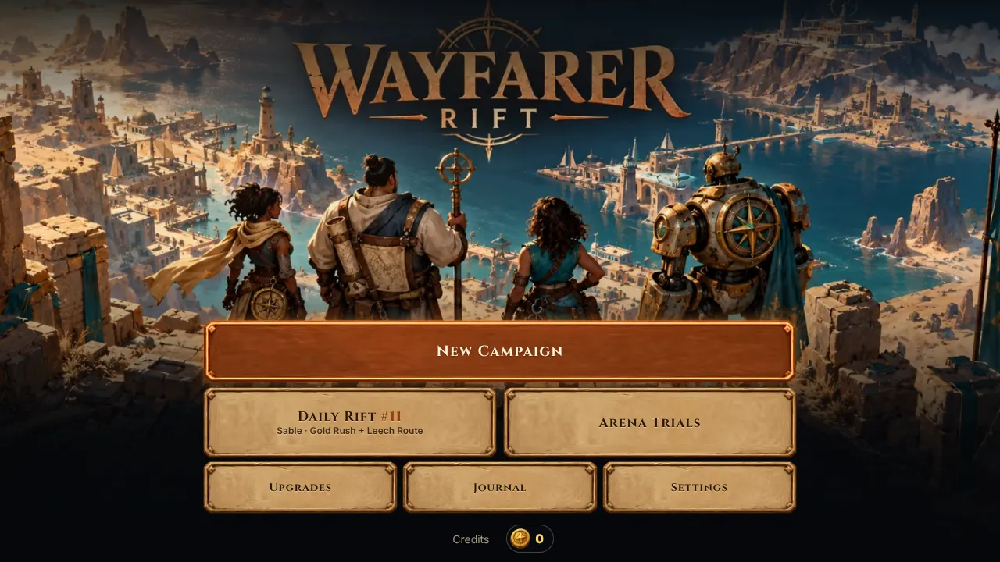
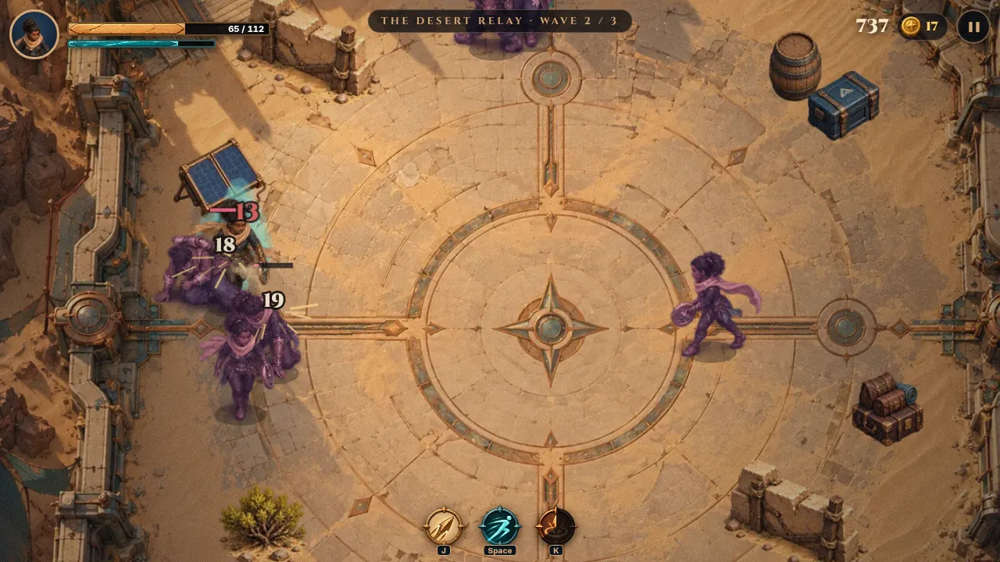
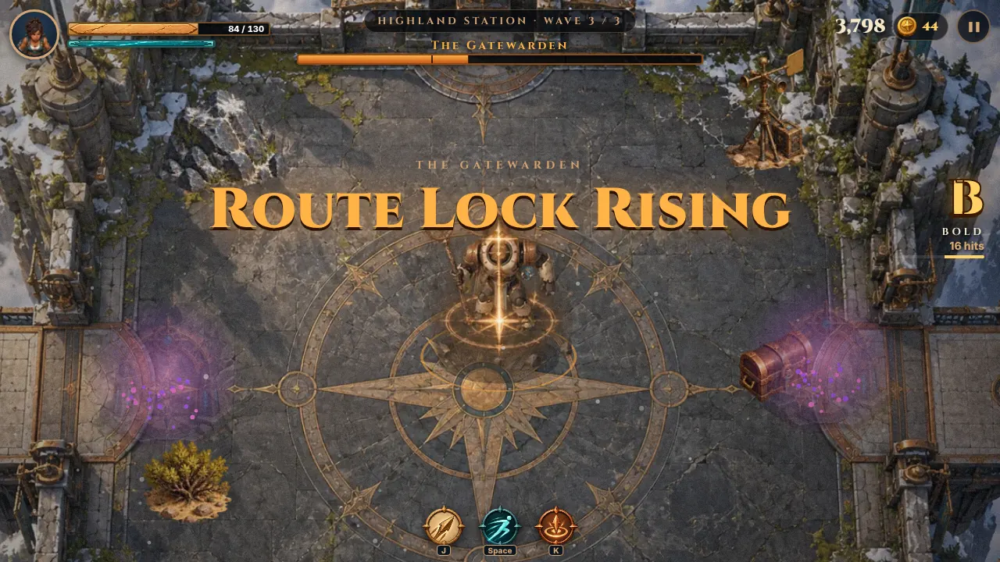
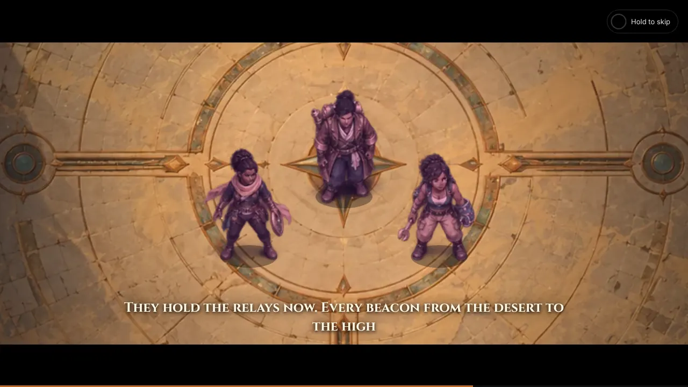
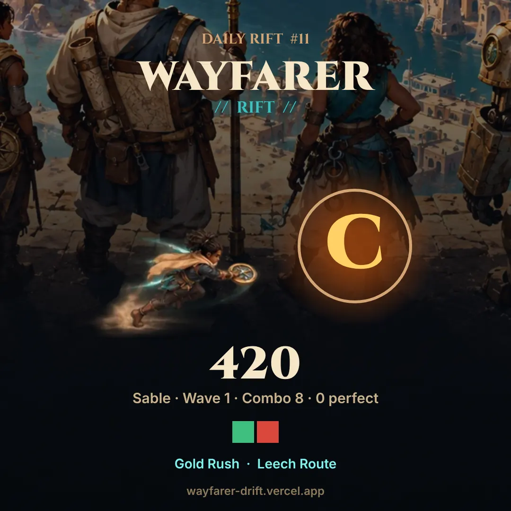
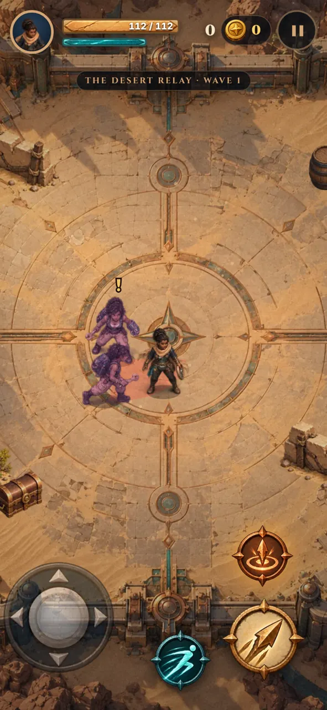

# WAYFARER // RIFT

**Play:** https://wayfarer-drift.vercel.app

A hand-painted, top-down 2.5D arena brawler built around every image in the Wayfarer // Rift asset pack. Runs in any modern browser on desktop, phone (portrait and landscape) and tablet, with keyboard, mouse, gamepad or touch, and installs as an offline PWA.

> Relight the beacons. Outplay the Echoes. Beat today's **Daily Rift**, then send your seed to a friend.

| | | |
|---|---|---|
|  |  |  |
|  |  |  |

## The game

- **Three travelers.** Sable the Courier (speed, Compass Dash blink), Rook the Cartographer (reach, Route Beacon control field), Iona the Tidekeeper (power, Tide Pulse shockwave that also heals).
- **Campaign:** three regions (Desert Relay, Tidal Port, Highland Station), three waves each, ending with a three-phase fight against **the Gatewarden**: telegraphed staff slams, route-lock lanes, expanding rune rings, summons, and a stagger meter that pays off aggression.
- **Echoes:** rift-touched copies of the travelers, recoloured in the pipeline so they always read apart from you. Each class has its own tell and counterplay: Sable lunges along a red line, Rook drops slowing fields, Iona charges a ring. Elites are gold-ringed and shrug off chip damage while winding up.
- **Combat feel:** a three-hit strike chain with soft aim-assist, buffered inputs, dodge-cancel recovery, hit-stop, screen shake, knockback, hit-flash silhouettes, damage numbers, slow-motion final blows, and **Perfect Dodges**: dodge through an attack at the last moment for slow-motion, stamina, and special charge.
- **Style meter** (D → C → B → A → S → SS "Wayfarer") multiplies your score. Breakable crates, chests and luggage drop route coins, field kits and relay cells.
- **Outfitter:** spend route coins on permanent Vitality, Edge, Focus and Stride upgrades shared by every traveler.
- **Animated cutscenes:** a prologue, two region interludes and a finale, each a sequence of shots with eased camera moves over the pack art, animated sprite actors that walk in, spawn and cast, a rift tear, beacon light pillars, shockwaves, weather (sand, sea spray, snow, embers), god rays, letterboxing, a typewriter subtitle track with per-traveler dialogue, and title cards. Tap to advance; hold to skip.
- **Daily Rift:** one seed a day for everyone. The date picks the traveler, the arena and two modifiers (Glass Cannon, Tailwind, Swarm, Overcharge, Leech Route, Elite Echoes, Knife Edge, Gold Rush). Waves are endless, with a Gatewarden every sixth. Your first run is your official score, and streaks are tracked.
- **Sharing:** one tap opens the native share sheet, or copies to the clipboard on desktop. You get a spoiler-free emoji wave strip (🟩 clean, 🟨 hit, 🟥 fell) plus a rendered 1080×1080 result card. Arena Trials share a **challenge link** (`?rift=<seed>.<region>.<traveler>&beat=<score>`) that drops a friend into the exact same seed with your score as the target.
- **Field Journal:** travelers, Echoes, all 16 props, all 16 kit/interface pieces, and lifetime records.
- **Accessibility:** assist mode (half damage, longer tells), reduced motion (respects the OS setting), a screen-shake slider, toggleable damage numbers, separate volume controls, full keyboard/gamepad menu navigation, live-text UI, 48px+ touch targets, safe-area insets, and haptics on touch devices.

### Controls

| Action  | Keyboard / mouse        | Gamepad          | Touch                |
|---------|-------------------------|------------------|----------------------|
| Move    | WASD / arrows           | Left stick / D-pad | Floating stick (left half) |
| Strike  | J / Z / left click      | A / X            | Strike button        |
| Dodge   | Space / Shift / right click | B / LB / triggers | Dodge button     |
| Special | K / C                   | Y / RB           | Special button       |
| Pause   | Esc / P                 | Start            | ❚❚                   |

The game also pauses on its own when the window loses focus.

## Development

Node 20+.

```sh
npm ci
npm run dev        # local dev server
npm test           # simulation, save, share and progression tests (Vitest)
npm run build      # typecheck → Vite build → content-versioned service worker
npm run preview    # serve dist/
npm run playtest   # drive the real build in Chromium, save screenshots to evidence/
npm run assets     # regenerate public/assets from source-art (Python 3 + Pillow + NumPy + SciPy)
```

### Architecture

| Path | Role |
|------|------|
| `src/simulation.ts` | Deterministic, DOM-free combat sim at a fixed 60 Hz: input buffering, combo chain, dodge/perfect-dodge, specials, Echo AI with attack tokens, Gatewarden phases and hazards, waves, pickups, props, scoring. Emits events; never touches rendering. |
| `src/render.ts` | Canvas 2D renderer: camera with look-ahead and boss framing, Y-sorted sprites, shadows, telegraphs, FX atlas playback, particles, afterimages, hit-flash cache, floaters, weather, lighting and vignette. |
| `src/cutscene.ts` | Cinematic engine and scripts (shots, camera eases, actors, effects, subtitles, title cards, skip). |
| `src/audio.ts` | Original procedural score (six adaptive tracks with an intensity layer) and every sound effect, synthesised in Web Audio. |
| `src/input.ts` | Keyboard, mouse, gamepad (including spatial menu navigation) and a floating touch stick, merged into one input frame. |
| `src/main.ts` | Screens, HUD, campaign / daily / trial flows, persistence and PWA wiring. |
| `src/share.ts` | Share text, result card renderer, challenge links. |
| `src/save.ts` | Versioned, validated `localStorage` saves. Corrupt data falls back safely. |
| `src/data.ts` | Roster, regions, waves, upgrades, modifiers, style ranks, journal copy. |
| `scripts/assets.py` | Asset pipeline (below). |
| `scripts/sw.mjs` | Generates the precaching service worker after each build. |
| `scripts/playtest.mjs` | Playwright run across desktop, phone portrait and phone landscape. |

### Asset pipeline

`source-art/` holds the 11 original PNG masters and their metadata, byte for byte as supplied (SHA-256 matches `source-art/manifest.json`). `scripts/assets.py` derives everything in `public/assets/`:

- **Haze removal:** the generated sheets carry a faint coloured haze across the whole canvas. A linear alpha remap clears it and keeps the anti-aliased edges. The FX sheet gets a steeper remap.
- **Pose ownership:** poses drift up to a third of a cell off the nominal 6×8 grid, and action trails cross cell borders. The pipeline erodes and labels the solid islands, finds the 48 body islands, orders them into rows and columns, and gives every remaining pixel (trails, dropped weapons, soft edges) to the nearest body. Frames no longer slice through bodies or bleed into their neighbours. Locomotion frames also drop stray debris.
- **Foot registration:** each frame is re-anchored on the centroid of its lowest solid rows, so idle and walk loops don't jitter. Frames are packed on a uniform grid with a shared pivot.
- **Rift variants:** traveler sheets are also exported with a violet and crimson value-preserving recolour for Echoes.
- Props are scaled to a ~110px traveler and packed with foot pivots. The FX, UI, arenas and title are cropped and exported as WebP. App icons and the social preview image are also generated.

Character attacks and specials in the source art face south only. In-game, strikes auto-aim in every direction: the action pose flips to match the facing, and the slash effect rotates to the true direction. Locomotion uses all four authored directions.

### Testing

- `npm test` runs 25 tests covering bounds and prop collision, stamina gating, single-hit-per-swing and the combo chain, aim assist, prop breaking, perfect dodges, all three specials and Iona's heal, full-region victory, defeat, assist mode, Gatewarden telegraphs, phase shifts and stagger, replay determinism, save validation and clamping, daily seeding, share text, and challenge-link round trips.
- `npm run playtest` plays the production build in Chromium: title → select → prologue → combat (scripted fighting) → pause freeze → results → interlude → Tidal combat → route map → Gatewarden intro, fight and phase shift → Daily Rift → share card and text → journal / upgrades / settings / trials. It then repeats key flows on a touch phone in portrait and landscape. It fails on any console error. Screenshots and `playtest.json` land in `evidence/`.
- CI (`.github/workflows/ci.yml`) runs typecheck, tests and build on every PR.

## Credits

Concept and creative direction: John-Ross Moyler (Hataalii), Collective AI Inc. Art: the Wayfarer // Rift asset collection (generated, user-supplied). Engineering, game design, narrative, cinematics and procedural audio: Claude Code. Cinzel is used under the SIL Open Font License. No third-party recorded audio is bundled.
